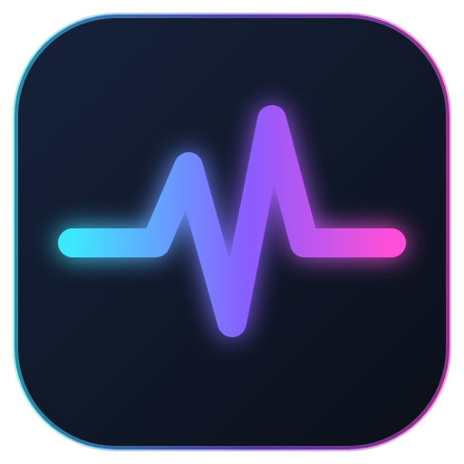
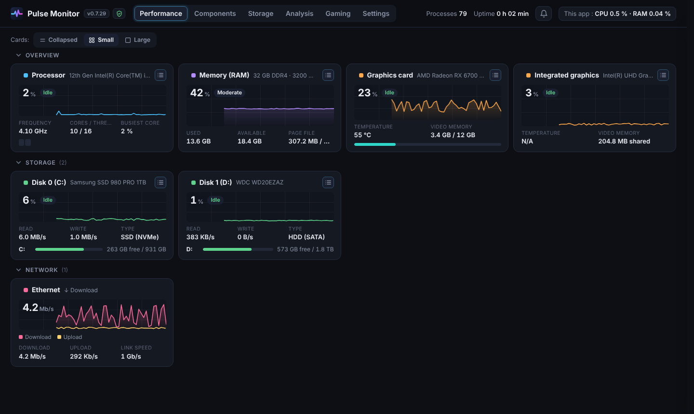
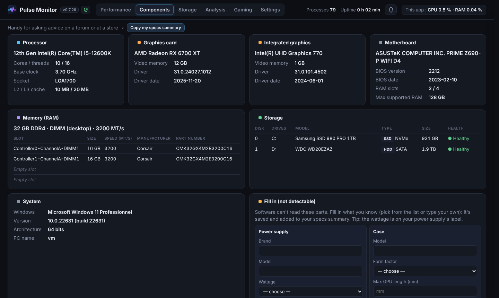
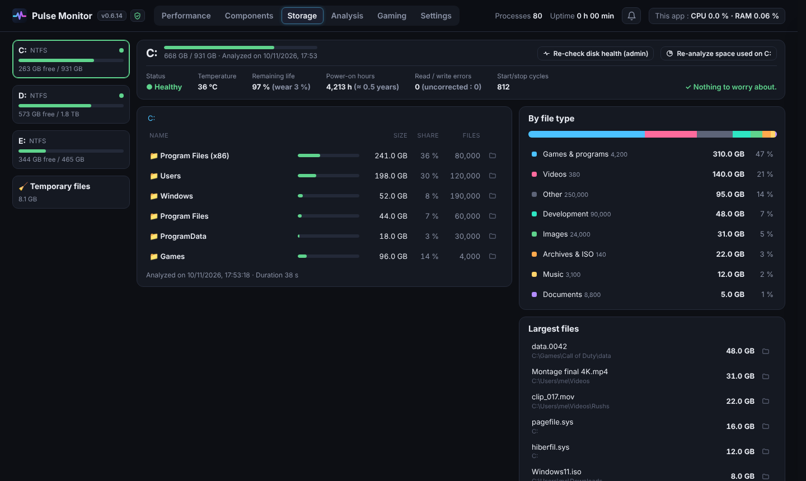
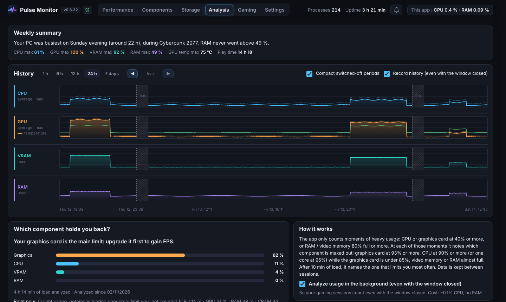
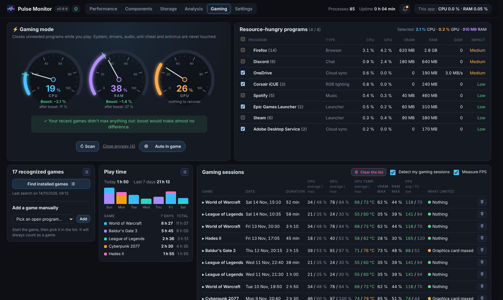

<h1 align="center">Pulse Monitor</h1>

<a href="README.md">English</a> · <b>Français</b>

Tableau de bord simple et léger pour Windows : performances du PC en temps réel (façon Gestionnaire des tâches), fiche des composants utile pour changer des pièces, analyse du stockage, santé des disques et rapports de sessions de jeu. 100 % local, aucune télémétrie.

Version actuelle : **v0.6.15**

## Télécharger

Dans les [Releases](https://github.com/leclodo/Pulse-Monitor/releases/latest) :
- **`Pulse-Monitor-vX-Setup.exe`** : installeur (menu Démarrer, raccourci Bureau, désinstallation depuis les Paramètres Windows). Les données vont dans `%LOCALAPPDATA%\Pulse Monitor`.
- **`Pulse-Monitor-vX-portable.zip`** : sans installation, dézippe et lance `Pulse Monitor.exe`. Les données restent dans le dossier.

## Aperçu

| Composants | Stockage |
|---|---|
|  |  |
| **Analyse** | **Gaming** |
|  |  |

## Ce qu'il affiche

**Performances** (mis à jour chaque seconde)
- Processeur : utilisation, fréquence réelle, charge par cœur
- Mémoire : utilisée / disponible, fichier d'échange
- Cartes graphiques : utilisation, température, mémoire vidéo
- Disques : activité, lecture / écriture, espace libre par lecteur
- Réseau : réception / envoi

**Composants**
- Processeur, carte mère + BIOS, barrettes de RAM (emplacements, vitesse, référence), cartes graphiques, disques (HDD/SSD, SATA/NVMe, santé), Windows, réseau, écrans
- **Infos à compléter** : alimentation, boîtier, refroidissement, ports M.2/SATA (listes pré-remplies)
- Bouton « Copier le résumé de ma config » pour demander conseil sur un forum

**Stockage** (façon TreeSize)
- Dossiers triés par taille, répartition par type de fichier, plus gros fichiers, « Ouvrir dans l'Explorateur »
- **Santé des disques** : état, température, durée de vie restante (SSD), heures, erreurs (lecture avec les droits administrateur, à la demande)
- **Fichiers temporaires** : fichiers temporaires Windows, mises à jour, caches des navigateurs / applis / shaders, miniatures, rapports de plantage, corbeille. Rien n'est supprimé.

**Analyse**
- Historique **1 h / 6 h / 12 h / 24 h / 7 jours** : CPU, GPU + température, RAM, VRAM (survol = valeurs + programme en cause)
- Quel composant te limite le plus (après 10 min d'usage intensif)

**Gaming**
- Jeu reconnu en 10 à 30 s (Steam, Epic, GOG, Battle.net, Riot… ou plein écran avec la carte graphique chargée)
- Rapport de chaque session : durée, GPU / CPU (moyenne / max), température, RAM / VRAM, ce qui limitait, et graphiques
- Recherche des jeux installés, ajout manuel de n'importe quel programme, pause / reprise du suivi

## Utilisation

- **Cloche 🔔** : conseils en direct (composant saturé, programme en cause, programmes au démarrage…). ✕ pour masquer un conseil.
- **Clic sur le titre d'une carte** (Performances) : liste des programmes qui utilisent la ressource. **Ctrl + clic** : masquer la carte (à réafficher dans Paramètres).
- Boutons **Cartes : Repliées / Petites / Grandes** en haut de Performances ; poignée **⋮⋮** pour réorganiser par glisser-déposer.
- **Paramètres** : langue FR / EN (celle de Windows par défaut), 5 thèmes, lancement avec Windows, garder en fond à la fermeture, vérification quotidienne des mises à jour.
- **Fermer la fenêtre (✕)** : l'appli reste près de l'horloge avec une petite icône (~30 Mo). Clic = rouvrir, clic droit = Quitter.
- **Widget de bureau** : CPU, GPU + température, VRAM, RAM sur une ligne (compact ou barres). 📌 = épinglé au-dessus de tout avec clics à travers (maintenir Ctrl pour le déplacer). Raccourci clavier configurable.
- **Mises à jour** : clic sur le numéro de version → « Vérifier les mises à jour ».
- Survole une donnée pour une explication courte.

## Vie privée

Tout reste sur ton PC : pas de compte, pas de publicité, pas de télémétrie, rien n'est vendu ni partagé. La seule connexion Internet est la vérification des mises à jour auprès de GitHub, quand tu la demandes (ou une fois par jour si tu actives l'option, désactivée par défaut). Détails dans l'appli : icône 🛡 à côté de la version.

## Léger

La fenêtre se ferme complètement quand on la quitte, les mesures ralentissent quand elle est réduite ou sur un autre onglet que Performances, et WebView2 tourne en mode allégé (un seul processus d'affichage, sans accélération GPU).

## Depuis le code source

- **Lancer** : double-clic sur **`Lancer Pulse Monitor.bat`** (installe `psutil`, `pywebview`, `pystray` et `Pillow` au premier lancement), ou `python pulse_monitor.py`.
- **Créer l'installeur et la version portable** : double-clic sur **`Creer l'exe.bat`**. Il installe PyInstaller (et Inno Setup si besoin) et crée les deux fichiers dans le dossier `release`.

## Limites

- Température du processeur : non disponible sans pilote spécial (comme dans le Gestionnaire des tâches).
- Alimentation, boîtier, ventirad et ports M.2/SATA : pas détectables par logiciel → à saisir dans « Infos à compléter ».
- Si la fenêtre s'affiche mal (page blanche) : lancer avec `--full-gpu`.
- En cas de souci, voir `pulse_monitor.log` (dans le dossier des données : Paramètres → Vie privée → « Ouvrir le dossier des données »).
