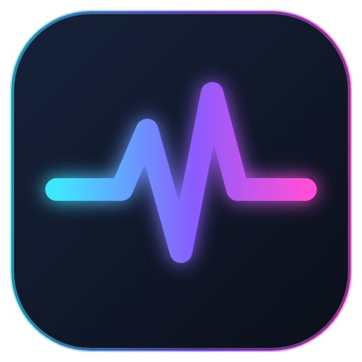
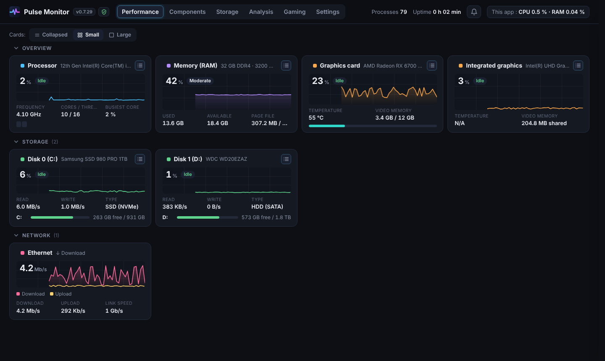
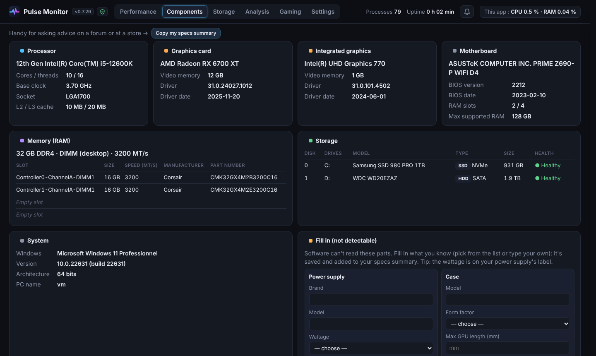
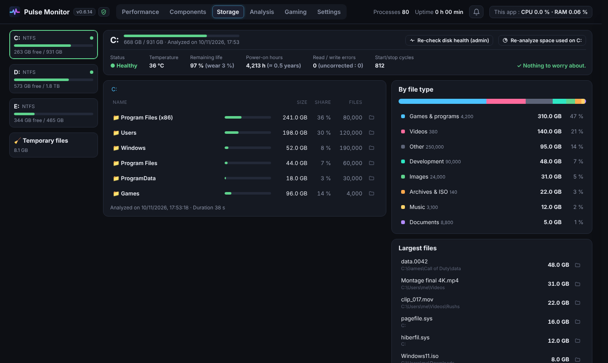
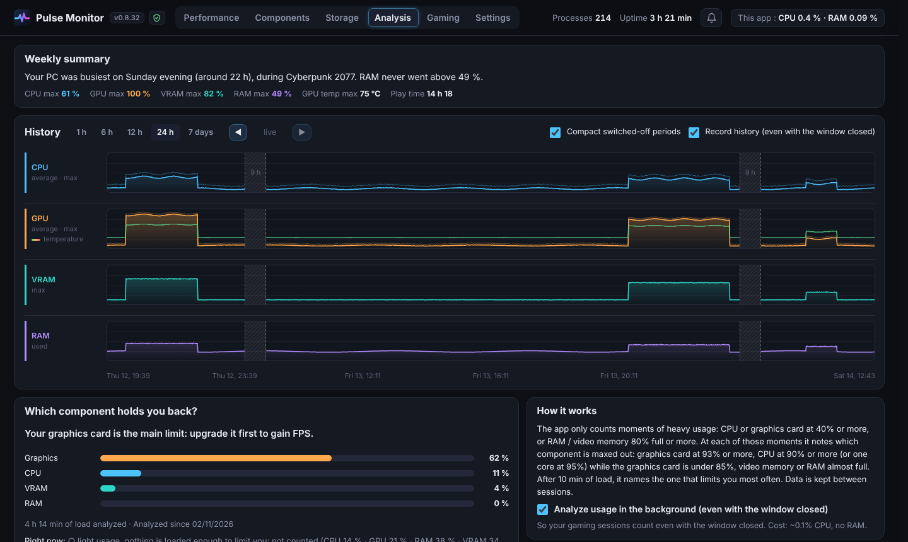
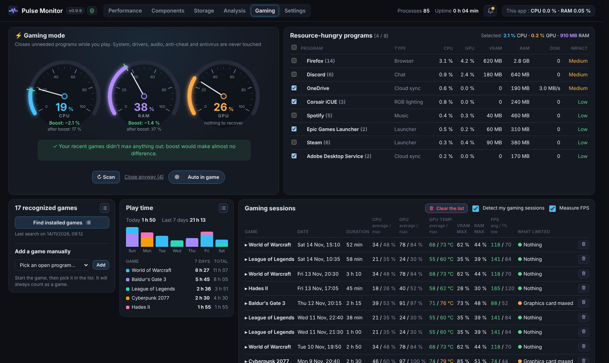
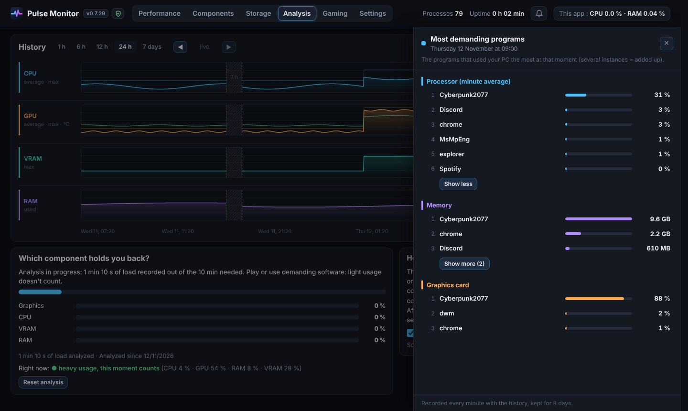
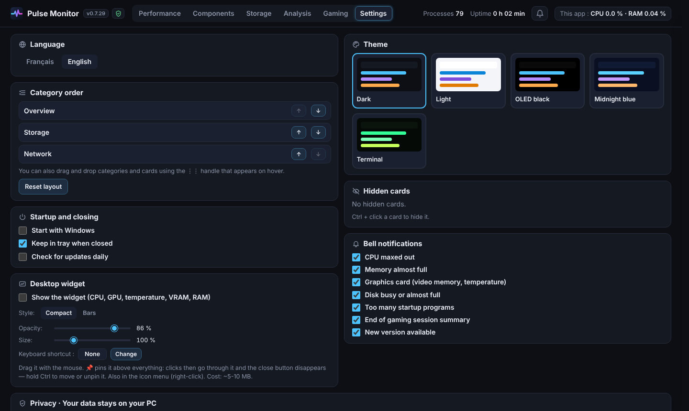

<h1 align="center">Pulse Monitor</h1>

<b>English</b> · <a href="README.fr.md">Français</a>

A simple, lightweight dashboard for Windows: real-time PC performance (like Task Manager), a hardware sheet with what you need to know when upgrading parts, storage analysis, disk health and gaming session reports. 100% local, no telemetry.

Current version: **v0.9.9**

## Download

From the [Releases](https://github.com/leclodo/Pulse-Monitor/releases/latest) page:
- **`Pulse-Monitor-vX-Setup.exe`**: installer (Start menu, desktop shortcut, uninstall from Windows Settings). Data is stored in `%LOCALAPPDATA%\Pulse Monitor`.
- **`Pulse-Monitor-vX-portable.zip`**: no installation, unzip and run `Pulse Monitor.exe`. Data stays in the folder.

## Screenshots

| Components | Storage |
|---|---|
|  |  |
| **Analysis** | **Gaming** |
|  |  |
| **Most demanding programs at a given moment** | **Settings** |
|  |  |

## What it shows

**Performance** (updated every second)
- CPU: usage, real clock speed, per-core load
- Memory: used / available, page file
- Graphics cards: usage, temperature, video memory
- Disks: activity, read / write, free space per drive
- Network: download / upload

**Components**
- Scan when you decide ("Scan components" button, then "Refresh"); results are kept between launches
- CPU (codename, P / E cores, caches, instruction sets, virtualization), motherboard + BIOS (chipset, UEFI, Secure Boot), RAM sticks (slots, channels, speed, timings, part number, warning if XMP / EXPO is off), graphics cards (chip, memory type, PCIe, driver age), disks (HDD/SSD, SATA/NVMe, health), Windows, network, displays
- No driver installed: everything is read with Windows' own tools
- **Fill in**: power supply, case, cooling, M.2/SATA ports (pre-filled lists)
- "Copy my specs summary" button to ask for advice on a forum

**Storage** (TreeSize-like)
- Folders sorted by size, breakdown by file type, largest files, "Show in Explorer"
- **Disk health**: status, temperature, remaining life (SSD), power-on hours, errors (read with administrator rights, on demand)
- **Temporary files**: Windows temp files, updates, browser / app / shader caches, thumbnails, crash reports, Recycle Bin. Nothing is deleted.

**Analysis**
- Weekly summary (when the PC was busiest and during which game, peaks of CPU / GPU / VRAM / RAM)
- Startup programs: what starts with Windows, the RAM each one uses, and a switch to turn it off (like Task Manager)
- Useful alerts in the bell: disk almost full, declining disk health, RAM often maxed out, old graphics driver
- **1 h / 6 h / 12 h / 24 h / 7 days** history (kept 8 days): CPU, GPU + temperature, VRAM, RAM
- Hover = values, click = the most demanding programs (CPU, RAM, GPU) at that moment
- Drag a chart (or ◀ ▶) to go back in time; changing the range zooms around the middle
- Switched-off periods compacted into a narrow band (optional) and always labelled
- Which component holds you back the most (after 10 min of heavy usage)

**Gaming**
- **Gaming mode**: closes unneeded programs while you play (cloud sync, launchers, chat, browsers…) and shows the RAM, CPU, disk and GPU it frees. Each program's impact is relative to your PC's hardware. Scan, a clear verdict (boost is only offered when it really helps), review the list (impact of each program), optimize; optional automatic mode when a game is detected. System, drivers, audio, anti-cheat and antivirus are never touched. "Restore" restarts everything afterwards
- Play time per day, per week and per game: one color per game, hover a day to see the time per game, large 7 / 30 / 90-day chart in the side panel. Deleting a session also removes its play time; a ⚠ temperature warning in the desktop widget when the graphics card runs hot during a game
- Games recognized within 10 to 30 s (Steam, Epic, GOG, Battle.net, Riot… or full screen with the graphics card under load)
- Report for each session: duration, CPU / GPU (average / max), GPU temperature, VRAM / RAM, **FPS (average / 1% low)**, what limited, and charts (hover for values, click for the most demanding programs)
- FPS read from Windows display events, no extra program (one-time permission if needed: "Performance Log Users" group)
- Find installed games (the list opens in the side panel), add any program manually, pause / resume tracking, or **stop tracking** a program that isn't a game (undo from "Never tracked")

## Usage

- **Bell 🔔**: live tips (saturated component, program responsible, startup programs…). ✕ to dismiss a tip.
- **Click a card title** or its ☰ icon: opens the side panel (programs using that resource in Performance, game list or large play time chart in Gaming). **Ctrl + click**: hide the card (restore it in Settings).
- **Cards: Collapsed / Small / Large** buttons at the top of Performance; **⋮⋮** handle to reorder by drag and drop.
- **Settings**: FR / EN language (Windows language by default), 5 themes, eco mode, start with Windows, keep in tray when closed, daily update check.
- **Close the window (✕)**: the app stays near the clock with a small icon (~30 MB). Click = reopen, right-click = Quit.
- **Desktop widget**: CPU, GPU + temperature, VRAM, RAM on one line (compact or bars), plus ● and the FPS while gaming. 📌 = pinned on top with click-through (hold Ctrl to move it), 🧲 snaps to screen edges. Adjustable opacity and size, configurable keyboard shortcut.
- **Updates**: click the version number → "Check for updates".
- Hover any value for a short explanation.

## Privacy

Everything stays on your PC: no account, no ads, no telemetry, nothing is sold or shared. The only Internet connection is the update check with GitHub, when you ask for it (or once a day if you turn the option on, off by default). Details in the app: 🛡 icon next to the version.

## Lightweight

The window is fully closed when you close it, measurements slow down when it's minimized or on a tab other than Performance, and WebView2 runs in lean mode (single render process, no GPU acceleration). An **Eco mode** (Settings) slows everything down further: measurements every 3 s, widget every 3 s, background analysis every 5 s, no animations. Storage scans are freed from memory after a few minutes.

## From source

- **Run**: double-click **`Lancer Pulse Monitor.bat`** (installs `psutil`, `pywebview`, `pystray` and `Pillow` on first launch), or `python pulse_monitor.py`.
- **Build the installer and the portable version**: double-click **`Creer l'exe.bat`**. It installs PyInstaller (and Inno Setup if needed) and creates both files in the `release` folder.

## Limitations

- CPU temperature: not available without a special driver (same as Task Manager).
- Power supply, case, cooler and M.2/SATA ports can't be detected by software → fill them in under "Fill in".
- If the window displays badly (blank page): run with `--full-gpu`.
- If something goes wrong, see `pulse_monitor.log` (in the data folder: Settings → Privacy → "Open the data folder").
